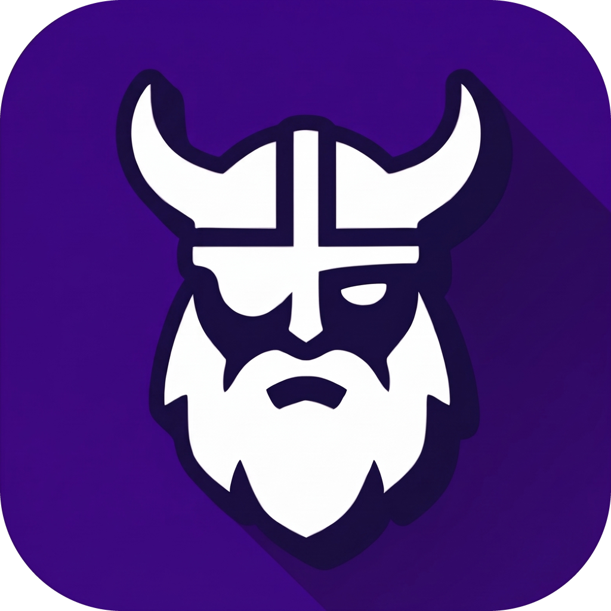

<p align="center">
  
</p>
<h1 align="center">Odin</h1>

<p align="center">
  <b>Parallelize agents, like a god.</b>
  <br><sub><b>O</b>rchestrator for <b>D</b>elegating <b>I</b>nbound <b>N</b>oise</sub>
</p>

<p align="center">
  <a href="LICENSE.md"></a>
  <a href="#install"></a>
  <a href="#windows-x64"></a>
  <a href="https://github.com/danlinenberg/odin/actions/workflows/release.yml"></a>
</p>

<p align="center">
  <a href="https://danlinenberg.github.io/odin/">Website</a> ·
  <a href="#install">Install</a> ·
  <a href="#the-idea">The idea</a> ·
  <a href="#the-loop">The loop</a> ·
  <a href="#everything-in-odin">Everything in Odin</a> ·
  <a href="#where-its-going">Where it's going</a>
</p>

---

Odin sat on a high seat and saw all nine worlds at once. Two ravens flew out
every morning and came back with everything that happened.

That is the job now. Running a dozen agents at once is easy. Seeing all of them,
knowing which one needs you, and sending the next one out before you lose the
thought is not. The only limit left on parallel agents is **your attention**,
and Odin exists to spend as little of it as possible.

Odin runs many CLI agents in parallel - on your machine, or on a cloud host when
the machine runs out of room - and keeps them next to the work that drives them:
a Slack thread, a Jira issue, a review request, a meeting tomorrow. One queue,
one board, one chat per agent, and a ping on your Mac or your phone the moment
one of them needs you.

## Install

### macOS (Apple Silicon)

```sh
brew trust --tap danlinenberg/odin && brew tap danlinenberg/odin && brew install --cask odin
```

### Windows (x64)

In PowerShell:

```powershell
irm https://github.com/danlinenberg/odin/releases/latest/download/Odin-Setup-x64.exe -OutFile $env:TEMP\Odin-Setup.exe; & $env:TEMP\Odin-Setup.exe /S
```

It installs silently for your user, with no admin prompt. Or download
**[Odin-Setup-x64.exe](https://github.com/danlinenberg/odin/releases/latest/download/Odin-Setup-x64.exe)**
and run it. The installer is not code-signed, so SmartScreen warns when you
open the download: click **More info**, then **Run anyway**.

Sessions need [Git for Windows](https://git-scm.com/download/win) on `PATH`;
a fresh Windows doesn't have it (`winget install Git.Git`).

### Upgrade

Odin updates itself. It checks on launch and every hour, and shows a banner when
a newer release is out; **Check for Updates…** in the menu asks right away.

- **macOS:** it downloads the DMG and swaps the bundle in place. Open terminal
  sessions survive, because the terminal-host daemon keeps running from the
  bundle the update parks aside.
- **Windows** (1.0.15 and later): it downloads the installer, runs it silently
  and reopens. From 1.0.16, open sessions survive too: the daemon runs from a
  copy under `~/.odin/runtime/<version>`, outside the folder the installer
  replaces. 1.0.14 and older have no updater - run the install command once.

### From source

Needs [Bun](https://bun.sh) at the version pinned in `.bun-version`:

```sh
git clone https://github.com/danlinenberg/odin.git
cd odin
bun install
./scripts/odin-dev.sh   # run it, with hot reload
bun run build           # or package one: apps/desktop/release/
```

Re-running `odin-dev.sh` is also the restart: it replaces the dev stack that is
already up, and live sessions survive it, because the terminal-host daemon is
adopted rather than torn down. Hot reload covers the renderer only. Edits under
`apps/desktop/src/renderer/` apply immediately; edits under `src/main/` need the
in-app **Restart Odin** button, or `ODIN_DEV_WATCH=--watch` to restart on every
save. Logs stream to `~/.odin/dev.log`, and the run that died is kept as
`dev.log.prev`.

### Windows from source

`odin-dev.sh` is macOS-only, but the dev build runs on Windows from Git Bash:

- **Node 20.11 or newer first on `PATH`.** `electron-vite` and
  `@electron/rebuild` run under it and need `import.meta.dirname`; on Node 18
  both fail with `The "path" argument must be of type string. Received undefined`.
- **Visual Studio Build Tools** with the "Desktop development with C++" workload,
  plus the Spectre-mitigated libraries for your architecture ("MSVC ... Spectre-mitigated
  libs" under Individual components; ARM64 on a Windows-on-ARM machine).
  `bun install` rebuilds the native modules for Electron, and several
  (`@parcel/watcher`, `native-keymap`) have no Windows prebuild for it; `node-pty`
  fails with `MSB8040` without the Spectre libraries.
- **A free renderer port.** The dev server insists on 5173; if another Vite app
  holds it, set `DESKTOP_VITE_PORT`.

```sh
bun install
cd apps/desktop
DESKTOP_VITE_PORT=5183 bun run dev
```

Windows on ARM can't run it from source: `mastracode` loads `@anush008/tokenizers`,
which has no `win32-arm64` binding, so the main process fails at load with
`Cannot find module '@anush008/tokenizers-win32-arm64-msvc'`. The x64 installer runs
there under emulation.

Terminal daemons listen on named pipes (`\\.\pipe\odin-*`) instead of socket
files.

## The idea

Most people run two systems and hold both in their head at once.

One is where the **work** lives: tickets, threads, review requests, a list
somewhere. The other is where the **agents** live: terminals, worktrees,
sessions. Neither knows the other exists. You read the first to work out what
matters, retype it into the second, and then pay for the gap in both directions -
the agent can't tell you which request it came from, and the request can't tell
you an agent ever touched it.

That split is a tax on the only thing that's actually scarce.

Running agents is no longer the hard part. What runs out is **your attention** -
deciding what to hand over, noticing which one is stuck, remembering what a
session was even about when you come back to it an hour later. Every agent you
add costs a little more of it, so your attention, not the hardware, sets how many
agents you can really run.

Odin's job is to make each agent cost less attention. Then you can run more of
them, at the pace you think of the work.

**Odin is one system.** Your queue and your agents are the same screen: a row in
the queue becomes a running session, the session remembers the row it came from,
and the board and the queue are two views of one pile of work rather than two
piles you reconcile by hand.

| | what it saves you |
|---|---|
| One queue across every source | "where do I even look" |
| A board by agent state | "which of these needs me" |
| A chat view with action items | "what do I have to do here" |
| Written briefs and provenance | "what was happening, and why did I start this" |
| Ping me and the phone app | "is it my turn yet" |
| The remote host | "my laptop can't take another one" |
| Huginn and rules | "how do I do that in Odin, again" |
| Drafts in your voice | "now I have to write the reply" |
| Night Agent | "when will I get to that" |
| Insights | "what's piling up" |

## The loop

**See what's on you → send out an agent → notice when it needs you → pick it
back up.**

That's the whole product. Everything below is one of those four steps.

### See what's on you

Every source lands in one queue:

- **Slack** - react `:eyes:` to a message and it becomes a row. The gesture you
  already make is the capture.
- **Jira** - issues assigned to or reported by you.
- **GitHub** - pull requests waiting on your review, bots filtered out.
- **Notion** - rows from a database you pick.
- **Email** - mail that asks something of you; calendar and service noise stay out.
- **Calendar** - today's and tomorrow's meetings, as things to prepare for.
- **ClickUp** - tasks assigned to you.
- **Tasks** - things you type in yourself, screenshots and files included.

The **All** tab is every source at once. Tab badges count what is genuinely
waiting on you, not how many rows exist, so a dependency-bump spree doesn't read
as work. **Search all** (⌘K) finds any row, card or past conversation, through a
typo. **Reminders** bring a row, a thread or a note of your own back on the day
you picked.

### Send out an agent

One click on any row starts a session: a real terminal agent, in its own git
worktree, with a prompt built from the item - the Slack thread and what was said
in it, the issue key and its description, the PR and what it changes. Tick a
dozen rows and launch them together.

Launches are paced to the hardware. If the Mac is already loaded, a new session
waits for room instead of starting into a swap storm, and says what it is
waiting for.

When the laptop is full, send the session to the **remote host** instead - an
EC2 instance you tag once. Odin sets it up over SSM (no open port, no SSH key),
syncs your Claude setup and connectors, keeps each session under its own memory
limit, and reconnects on its own when the link drops. Several people can share
one host, each as their own Linux user with their own git identity. **Run here**
pulls a session and its code back to your Mac mid-conversation. How to make a
host: [docs/remote-host.md](docs/remote-host.md).

Odin drives whichever agent CLI you use, with your own subscription. Nothing is
proxied. When the plan's limit hits, it can switch to your API key and keep
going.

Work you won't get to today can wait for the **Night Agent**. It runs your queued
tasks overnight, on the Mac or the host, so the morning starts with finished
sessions and a "Last night" card of what ran, instead of a backlog.

### Notice when it needs you

The **Dev Board** is a kanban over live agent state, not ticket state:

```
Working        Needs you        Final review        Idle
```

Cards group by where the work came from, so nine cards read as "four Slack
threads, two Jira, three of mine" rather than an undifferentiated list. Statuses
come from agent lifecycle hooks, with the session's own screen read as a fallback
so a card stranded by a lost hook still corrects itself. A conversation is
compacted as it goes idle, so picking it up later is cheap.

You don't have to watch the board to know when to look:

- **Action items** - every agent reply ends with the few things only you can do
  next. A choice is a row of buttons. A command for you gets a **Run** button,
  on this machine or **Run on my computer** for a remote session. Dismiss one
  and it's gone.
- **Ping me** - Odin watches a session's Slack thread, the DMs it drafted into
  and its pull requests, and pings you when someone replies or a PR is approved.
  **Ping me when...** lets the agent watch for anything you describe.
- **On your phone** - the Odin iPhone app has the whole board, every session's
  chat, brief and action items, search, and new tasks. Dictate a reply (the
  Action Button starts it), attach a photo, swipe a card for its actions. Traffic
  is end-to-end encrypted through a relay that can't read it:
  [the phone and Odin](docs/phone-encryption.md).

### Pick it back up

Re-entry is where the time actually goes, so it gets real machinery:

- **Chat view** - each session reads as a conversation, not a terminal: your
  messages, the agent's replies folded to a TL;DR, its steps while it works, and
  its subagents in their own tab. Paste a screenshot, drop a file, `@` a file
  from the checkout, or have the reply read aloud. The terminal is one click away.
- **Briefs** - a model reads the transcript and answers "what did I walk into?",
  including the session's PRs, whether one has conflicts, and whether it runs on
  your plan or an API key.
- **Diff review** - the session's changes since main, PR or not. Comment on
  lines, send the comments to the agent, tick files as reviewed.
- **Session History** - search every agent conversation on the machine by what
  was *said* in it, read it, resume it. Each row is tagged with where it came
  from.
- **Docs** - save a session as a knowledge doc and hand it to the next task.

Terminal sessions are owned by a background daemon, so they survive the window
closing, the app restarting, and the app being updated under them.

## Everything in Odin

Beyond the loop:

- **Huginn** - Odin's raven. Ask him in plain words to do anything Odin can do,
  and he does it, so you never stop to look for the right screen.
- **Rules** - standing orders for every session, scoped to a repo if you like:
  "when you open a PR in this repo, auto-merge it". Tell Huginn and he writes
  them.
- **Drafts in your voice** - Odin learns how you write from your own Slack
  messages and your corrections, so the replies agents draft for you sound like
  you.
- **In-app browser** - open a Slack thread or a PR without leaving Odin, signed in
  with your browser's sessions, logins filled from the 1Password app.
- **Insights** - how much lands on you, how much you hand over, how long things
  sit, who asks most, and how many agents ran side by side each week.
- **Profiles** - work and personal kept apart, one click to switch, on the Mac and
  the phone.
- **Updates** - Odin updates itself, and live sessions survive the update.

## What Odin is not

These are constraints, not gaps. They are what let it be opinionated.

- **Not a team tool.** One person drives it. A shared remote host gives each
  person their own user and sessions, but there is no assignment, no shared
  board and no seats. The moment it serves a team it has to serve the average of
  a team.
- **Not a hosted service.** Odin runs on hardware you own or rent: your Mac,
  and a host in your own cloud account. Nobody else's server sees your work.
- **Not fire-and-forget.** Odin is built to put you back in the loop at the right
  moment, not to hand you finished work you never watched.
- **Not an editor.** It starts, watches and reviews. You still open your IDE.

## Who it's for

The person who is a **human router**: work arrives as pings, review requests and
tickets other people filed. Most of it could be handed to an agent. More time
goes to re-entering context than to writing code.

In one line - **an agent launcher for people whose work doesn't arrive as
tickets.**

## Where it's going

The arc is **inbox → router**.

Today Odin shows you the queue and you make most of the calls: which item, which
repo, which prompt. Rules and Huginn already take some of those off you. Most of
the rest are small judgments made dozens of times a week, and they aren't
interesting.

The direction is that Odin proposes and you approve - *this looks like the
export-retry kind of ask, repo X, here's the prompt, go?* - with rejecting a
suggestion cheap enough that a wrong guess costs one keystroke. Getting there
means recording not just what you delegated but how it turned out, and having
enough history to see the pattern.

The endpoint is not agents working unattended. It is that the routine fraction
drains itself, and **what reaches you is the work that actually needs a human.**

## Status

Pre-production. It is used daily by the person building it, which is the only
quality bar it currently has to clear.

## License

Elastic License 2.0. See [LICENSE.md](LICENSE.md).
